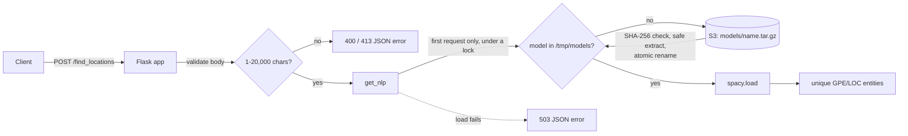

# Location extraction with S3-hosted spaCy models

A small Flask API that returns place names from text using spaCy's `GPE` and `LOC` entities. Model archives live in S3 and are cached under `/tmp/models` instead of being shipped inside the deployment bundle, which keeps the Lambda package small at the cost of a download on cold start.

## How a request is served



Design choices worth knowing:

- **One model load per process.** The first request loads the model under a lock, so concurrent cold-start requests wait for one download instead of each fetching and loading their own copy. A failed load is not cached; the next request retries.
- **Archives are treated as untrusted input.** Extraction rejects absolute paths, `..` segments, links and special files, caps the archive at 10,000 entries and 1 GiB declared size, and uses Python's `tarfile` `filter='data'`. When `SPACY_MODEL_SHA256` is set, the archive must match it before anything is unpacked. Unpacking happens in a staging directory that is renamed into place, so a rejected or interrupted install never looks like a cached model. The S3 archive is deleted after unpacking to save `/tmp` space.
- **Bounded input.** The body must be JSON with exactly one string field, `text`, of 1 to 20,000 characters. Bodies over 128 KiB are refused with 413 before any parsing or model work.
- **Errors are always JSON** and never include stack traces, bucket names or other internals.

A checksum only proves the archive is the one you meant if you got the hash from an independent, trusted source. It does not make an arbitrary spaCy model safe to load.

## API

All examples below were captured from the Docker image in this repository running the `blank:en` pipeline. A blank pipeline has a tokenizer but no named-entity recognizer, so it returns an empty list. With a trained model such as `en_core_web_md-3.8.0`, the same request typically returns `["Spain", "UK"]`, although exact results depend on the model.

```http
GET /
```
```
200 {"endpoint":"POST /find_locations","service":"location extraction"}
```

```http
POST /find_locations
Content-Type: application/json

{"text": "Spain is a sunnier country than the UK"}
```
```
200 []
```

Results are unique entity strings in first-appearance order. They are not ranked, geocoded or normalised to place IDs.

Error responses:

| Request | Status | Body |
| --- | --- | --- |
| `{"text": ""}` | 400 | `{"error":"text must contain 1 to 20000 characters."}` |
| `{"text": "Spain", "lang": "en"}` | 400 | `{"error":"Provide one JSON string field named text."}` |
| a 140 KB JSON body | 413 | `{"error":"The data value transmitted exceeds the capacity limit."}` |
| `GET /find_locations` | 405 | `{"error":"The method is not allowed for the requested URL."}` |
| model cannot be fetched or loaded | 503 | `{"error":"The language model is not available. Try again later."}` |

The service has no authentication, rate limiting or per-user quota. Keep it private until those are in place.

## Run it locally

### With Docker

```sh
docker build -t text-analysis-service .
docker run --rm -p 8000:8000 text-analysis-service
curl -s -X POST localhost:8000/find_locations \
  -H 'Content-Type: application/json' \
  -d '{"text": "Spain is a sunnier country than the UK"}'
```

The image runs gunicorn as a non-root user with one worker and four threads, and defaults to `SPACY_MODEL_MEDIUM=blank:en` so it starts without S3. To use a real model, pass the model name and bucket, and give the container AWS credentials through your usual mechanism:

```sh
docker run --rm -p 8000:8000 \
  -e SPACY_MODEL_MEDIUM=en_core_web_md-3.8.0 -e S3_BUCKET=your-model-bucket \
  -e AWS_REGION -e AWS_ACCESS_KEY_ID -e AWS_SECRET_ACCESS_KEY -e AWS_SESSION_TOKEN \
  text-analysis-service
```

### With a virtual environment

Python 3.12 is pinned in `.python-version`.

```sh
python3.12 -m venv .venv
. .venv/bin/activate
pip install -r requirements-dev.txt
cp .env.example .env        # set SPACY_MODEL_MEDIUM=blank:en to skip S3
./run_local.sh              # http://127.0.0.1:5001
```

## Configuration

| Variable | Purpose |
| --- | --- |
| `SPACY_MODEL_MEDIUM` | Versioned model the API loads, such as `en_core_web_md-3.8.0`, or `blank:<lang>` for a download-free tokenizer-only pipeline. |
| `S3_BUCKET` | Bucket that holds `models/<model>.tar.gz`. |
| `SPACY_MODEL_SHA256` | Optional. 64-character hex digest the archive must match. |
| `SPACY_MODEL_SMALL` | Model used by the `manage_models` command-line helper. |
| `SENTRY_DSN` | Optional error reporting. Default PII collection is off, but request text can still appear in diagnostics, so don't send private documents. |

S3 access uses boto3's normal credential chain. Keep credentials out of Git, use a private bucket and limit the role to the model objects it needs.

## Preparing model storage

`src/manage_models.py` can fetch a versioned archive from the official `explosion/spacy-models` GitHub releases and upload it to your bucket:

```sh
python -m src.manage_models --download --upload   # uses SPACY_MODEL_SMALL and S3_BUCKET
```

The model version must match the installed spaCy minor version (3.8 here). The helper checks `SPACY_MODEL_SHA256` before uploading when it is set. It does not create the bucket, IAM permissions or an encryption policy.

## Tests and lint

```sh
pip install -r requirements-dev.txt
python -m pytest
ruff check . && ruff format --check .
```

The suite runs offline. S3 is mocked with moto, and the NLP tests use `spacy.blank("en")` with an entity ruler, so no model is downloaded and no AWS account is touched. It covers request validation and JSON error responses, archive traversal, link, setuid and checksum handling, cache atomicity after failed installs, and single loading under concurrent cold starts.

## Deploying to AWS Lambda

Zappa is the deployment path, configured in `zappa_settings.json` for `python3.12` with `slim_handler`. Every account-specific value in that file is a placeholder (`your-aws-region`, `your-zappa-deployments-bucket`, `your-model-bucket`, profile `default`), so fill them in first. Zappa is kept out of the runtime dependencies:

```sh
pip install -r requirements-deploy.txt
zappa deploy dev
```

Why Zappa: the code already targets it, version 0.63 supports Python 3.12, and `slim_handler` works around Lambda's 250 MB unzipped limit, which a spaCy install and its dependencies can approach. The settings ask for 2 GB of ephemeral storage because the slim bundle and the unpacked model both land in `/tmp`. Zappa is lightly maintained, though. If it falls behind Lambda runtimes, the better option is a container-image Lambda (up to 10 GB) built from an AWS Lambda Python base image, which could also bake the model in and remove the S3 cold-start download. The Dockerfile here is for local runs, not a Lambda image.

This upgrade did not deploy anything. The Zappa configuration, the Lambda memory and storage sizing and live model recognition have not been verified against AWS.

## License

MIT, see [LICENSE](LICENSE).
